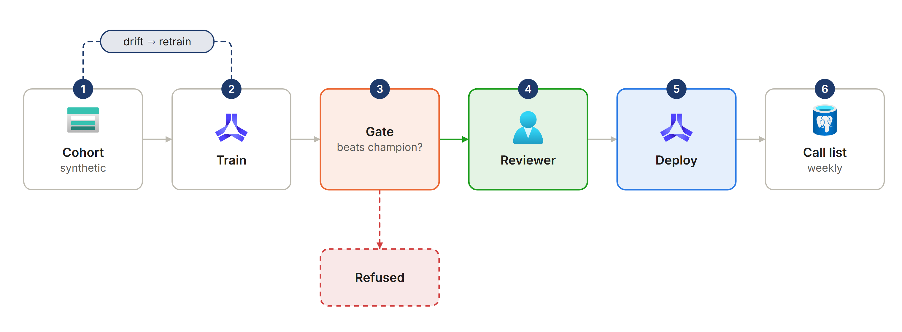
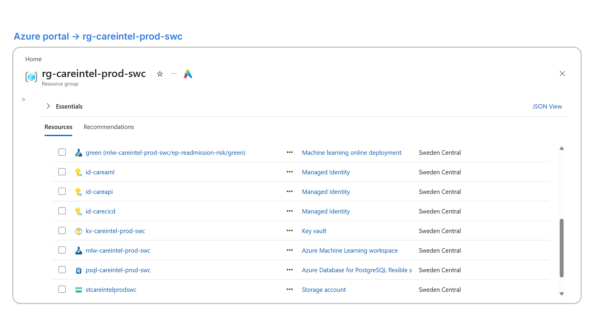
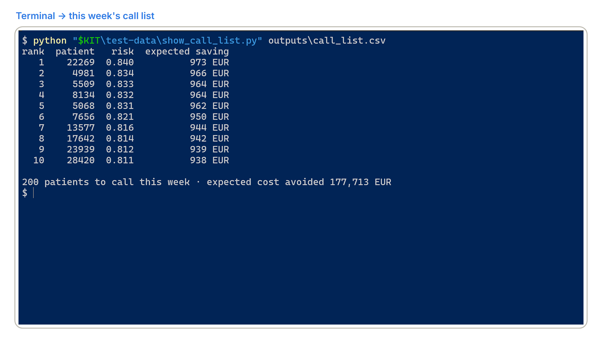
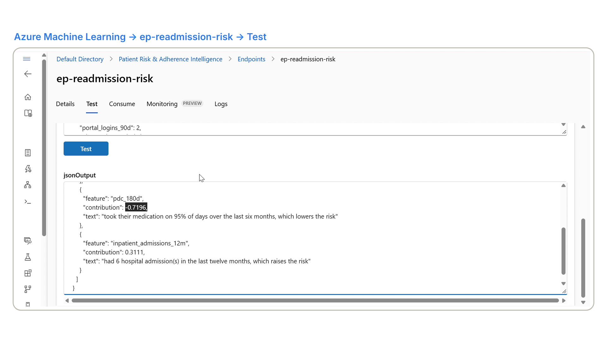

# Patient Risk & Adherence Intelligence

Which two hundred patients should a care team call this week, and what does it save? A
readmission-risk model on Azure Machine Learning whose headline number is **cost avoided per
thousand patients contacted**, not AUC: a capacity-constrained expected-value threshold decides
who is called, every score comes with a plain-language explanation, every cohort is audited for
fairness, and the model card says what the system must never be used for.

> **All data in this repository is synthetic.** The cohort is generated by `src/data/synthesize.py`
> with CTGAN from published chronic-disease adherence distributions and a documented causal
> structure. No real patient record was used, seen or approximated. The schema follows OMOP
> Common Data Model naming so that a health-data reviewer recognises it, and for no other reason.

**This repository contains no agent, by decision.** Nothing here is open-ended, conversational or
tool-driven: it is supervised learning on tabular data with a deterministic serving path, and the
rule *if you can write a function to handle the task, do that instead of using an AI agent* applies
to the whole repository (ADR-013).

## The problem

A medical director running a chronic-care programme pays for every avoidable readmission, which
costs thousands of euros, and can afford a few hundred preventive nursing calls a week, which cost
tens. Non-adherence to treatment is the strongest lever they have, but today the call list is
built from rules of thumb, so the calls reach patients who would have been fine and miss patients
who come back within a month. Their question is not "what is your model's AUC?" but **"which two
hundred patients do I call this week, and what does it save me?"** This repository answers it with
a ranked list, the expected value of each call, the reason behind each score and a fairness audit
of who the list reaches.

## Lifecycle



`docs/architecture.md` has the full lifecycle and the network and identity diagram.



## In action

This week's call list from the batch endpoint: the two hundred patients to call and the expected
cost avoided.



The registered model scored live in Azure Machine Learning studio. Each driver is a SHAP
contribution phrased by a fixed template; with adherence raised to 95 % for the same patient, the
medication driver turns negative.



## What this demonstrates

| Capability | Where |
|---|---|
| A business metric as the objective: cost avoided per thousand contacts under capacity | `src/economics.py`, ADR-005, experiment 002 |
| Four YAML components composed by `@pipeline` on serverless compute, every metric in MLflow | `src/components/`, `pipelines/training.py`, ADR-001, ADR-002 |
| Registration earned, not automatic: the gate refuses a challenger that does not win | `src/components/register.py`, ADR-003, `tests/test_evaluation.py` |
| A Bayesian sweep optimising the logged business metric | `pipelines/training.py --sweep` |
| Promotion behind a GitHub Environment with a named reviewer, blue/green with rollback | `.github/workflows/deploy-prod.yml`, ADR-004 |
| Explanations by deterministic templates over SHAP, never a language model | `src/scoring/score.py`, ADR-012 |
| Fairness audited at the operating point, and the cost of mitigating it measured | `src/fairness.py`, experiment 003, model card |
| Precedents by cosine similarity over SHAP embeddings in PostgreSQL | `src/cohorts.py`, ADR-006 |
| Drift that retrains but never promotes | `src/monitoring/drift.py`, `drift-check.yml`, ADR-007 |
| Identity at every hop, no keys anywhere | `infra/`, `docs/security.md`, ADR-014 |

## Quick start

Prerequisites: the landing zone deployed, Python 3.12, the Azure CLI with the `ml` extension, and
an Azure login with Contributor on `rg-careintel-prod-swc`.

```
python -m venv .venv && . .venv/bin/activate
make install install-synth          # runtime, tooling, and SDV + torch for the generator
make check                          # ruff, mypy, pytest with the budget
make lz-env                         # landing zone outputs into the azd environment
azd env set OPERATOR_IP <your public address>
azd env set GITHUB_SUBJECT_PREFIX "$(gh api repos/<owner>/<repository>/actions/oidc/customization/sub --jq .sub_claim_prefix)"
make deploy                         # infrastructure and API; on a machine without Docker,
                                    # az deployment group create -f infra/main.bicep -p infra/main.bicepparam
make pg-roles PG_ADMIN=<your UPN>   # PostgreSQL roles, schema and grants, as the Entra admin
cp .env.example .env                # then fill in the values from `azd env get-values`
make synth                          # the synthetic cohort, deterministic for the seed
make data                           # registers it as the next version of patient-cohort
make pipeline                       # prep → train → evaluate → register, on serverless compute
make endpoints                      # online and batch endpoints for the champion
make batch                          # this week's call list into PostgreSQL
make api                            # the API locally, REQUIRE_AUTH=false
```

### GitHub bootstrap

1. **App registration** for the API, with the app role `Care.Read` assigned to the people who may
   read the call list; set `API_APP_CLIENT_ID` in the azd environment and deploy again.
2. **Repository secrets** `AZURE_CLIENT_ID`, the client id of `id-carecicd` from the deployment
   output `cicdClientId`, `AZURE_TENANT_ID`, `AZURE_SUBSCRIPTION_ID` and `AML_IDENTITY_CLIENT_ID`,
   the output `amlIdentityClientId`; **repository variable** `POSTGRES_HOST`.
3. **Environment `production`** with yourself as required reviewer. Without the protection rule
   `deploy-prod.yml` would deploy on dispatch.
4. **Federated credentials** are created by Bicep on `id-carecicd`, one per OIDC subject:
   `ref:refs/heads/main` for the merge, schedule and dispatch workflows, `pull_request` for
   `train-dev.yml`, and `environment:production` for `deploy-prod.yml`. A job that declares an
   environment presents `environment:<name>` as its subject rather than the branch, so without the
   third credential the first production deployment fails with `AADSTS700213`. Each subject starts
   with the repository's prefix exactly as GitHub issues it, `GITHUB_SUBJECT_PREFIX` above: for a
   repository with immutable subject claims it carries the owner and repository ids,
   `repo:<owner>@<owner id>/<repository>@<repository id>`, and a credential written as
   `repo:<owner>/<repository>` fails with the same `AADSTS700213`.

## Results

> Synthetic data, modelling assumptions: 35 € per contact, 4,800 € per readmission, and an
> intervention that prevents 25 % of the readmissions it reaches. No number here is a clinical
> result.

| Metric, test split of 6,000 patients | Champion, gradient boosting |
|---|---|
| **Cost avoided per thousand contacts**, top 2 % | **875,000 €** |
| Precision among the 120 contacted | 0.758 |
| AUC | 0.756 |
| Brier score / expected calibration error | 0.129 / 0.014 |

- **The policy is the product.** The F1-optimal threshold would ask for 1,863 calls at 423,000 €
  per thousand; the capacity policy makes 120 at 875,000 € (experiment 002).
- **The simpler model ties.** A logistic regression scores AUC 0.757 and 865,000 €, because the
  generator's label is log-linear; the boosted model is kept for the lifecycle, and the gate kept
  the incumbent on the tie (experiment 001).
- **Fairness has a measured price.** Equalising selection across age bands costs 16 % of the value
  because risk differs by age; the insurance gap closes at no cost with a need-proportional quota
  (experiment 003).
- **The weekly deliverable.** The batch endpoint scored 40,000 patients and the call list holds 200
  contacts with an expected 177,713 € avoided, 889 € per call, priced by the same code as the gate
  (`docs/batch-weekly-2026-10-21.json`).

`docs/evaluation.md` has the calibration curve and the subgroup breakdown;
`docs/evaluation-v1.json` is the report behind every figure above; the sweep and the weekly batch have
their own reports next to it.

## Cost

A training run costs about five cents of serverless compute and the weekly batch about one; the
always-on line items are PostgreSQL B2s, about 26 € a month, and the online endpoint on
`Standard_DS1_v2`, about 44 € a month, which is deleted between demonstrations. A persistent training node would cost 175 € a
month. Details in `docs/cost.md`.

## Decisions

| ADR | Decision |
|---|---|
| 001 | Four components and a pipeline, not one training script |
| 002 | Serverless compute; one cluster at zero nodes for batch and sweep trials |
| 003 | Registration gated on cost avoided per thousand contacts |
| 004 | Champion and challenger through GitHub Environments |
| 005 | An expected-value threshold under capacity, not an F1 optimum |
| 006 | pgvector for cohort similarity |
| 007 | Drift triggers retraining, never promotion |
| 008 | Synthetic data generation, and what it cannot show |
| 009 | Rejected: deep learning on tabular data at this size |
| 010 | Rejected: a feature store at this scale |
| 011 | Rejected: real-time streaming; batch is the cadence |
| 012 | Explanations by deterministic template, not by language model |
| 013 | Rejected: an agent anywhere in this repository |
| 014 | App-role authorisation instead of a network boundary |

## Model card

[`docs/model-card.md`](docs/model-card.md): intended use, out-of-scope uses, training data and its
synthetic provenance, evaluation overall and by subgroup, limitations, and the ethical
considerations around acting on a risk score. **The system prioritises outreach and never makes a
clinical decision.**
