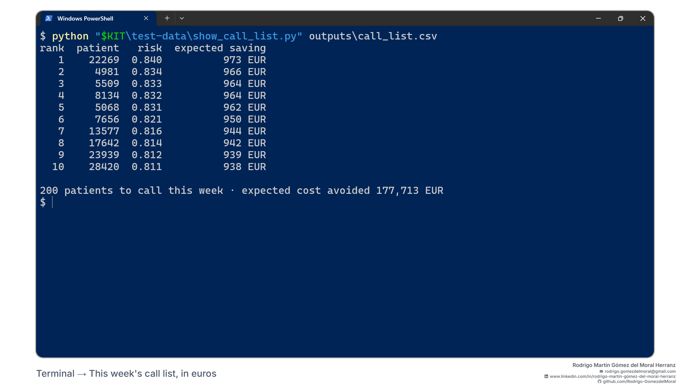
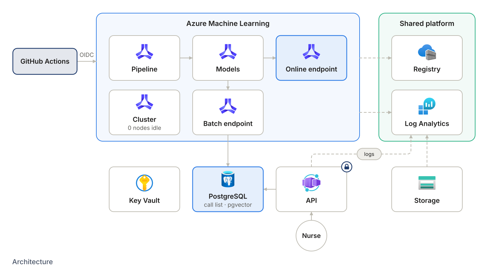
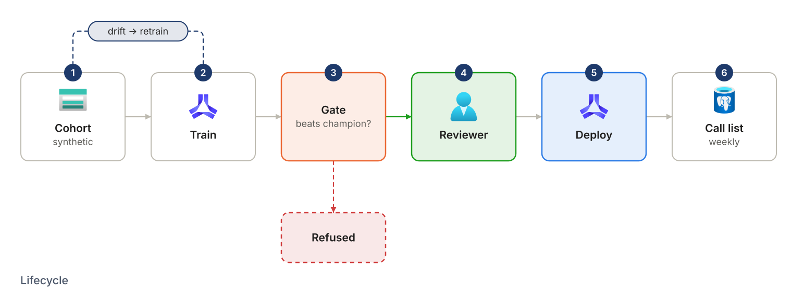
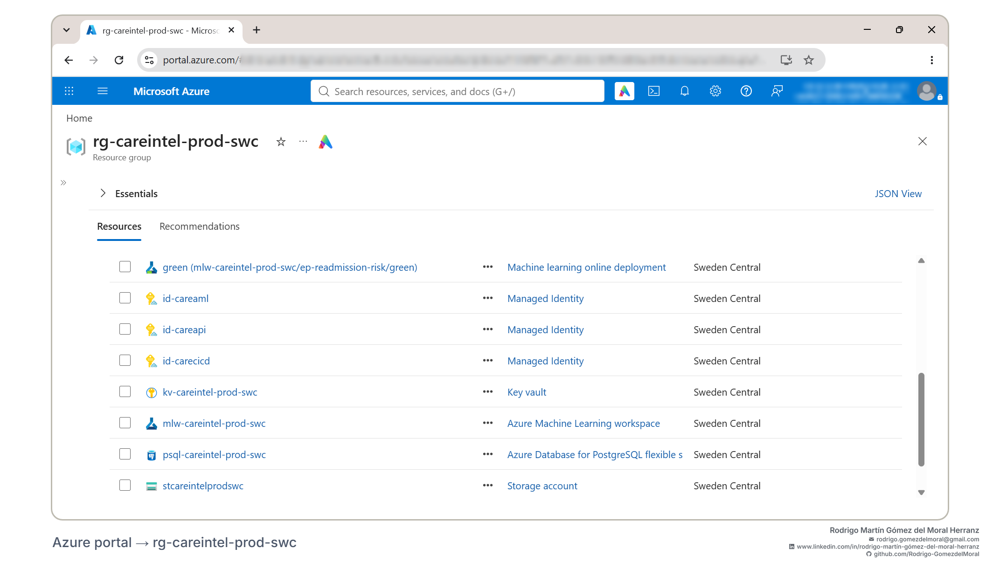
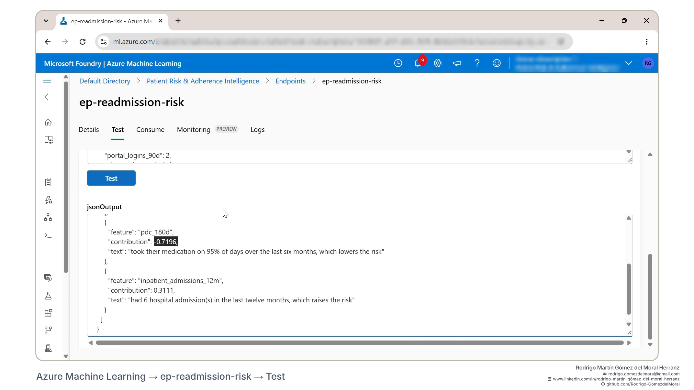
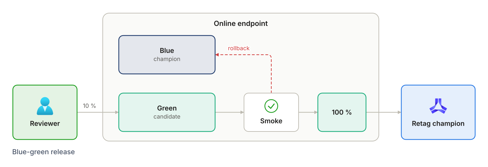

# Patient Risk & Adherence Intelligence

Built by **Rodrigo Martín Gómez del Moral Herranz**

<a href="mailto:rodrigo.gomezdelmoral@gmail.com"></a>&nbsp;&nbsp;<a href="https://www.linkedin.com/in/rodrigo-mart%C3%ADn-g%C3%B3mez-del-moral-herranz"></a>&nbsp;&nbsp;<a href="https://github.com/Rodrigo-GomezdelMoral"></a>&nbsp;&nbsp;<a href="https://rodrigogomezdelmoral.es"></a>

Which two hundred patients should a care team call this week, and what does it save? A
readmission-risk model on Azure Machine Learning whose headline number is **cost avoided per
thousand patients contacted**, not AUC: a capacity-constrained expected-value threshold decides
who is called, every score comes with a plain-language explanation, every cohort is audited for
fairness, and the model card says what the system must never be used for.

<p align="center"><a href="https://rodrigogomezdelmoral.es/en/projects/azure-care-intelligence-platform#video"></a></p>

**Built to standard.** This AI solution is designed, built, validated and operated in alignment with the **Microsoft
Responsible AI Standard** (Fairness, Reliability and Safety, Privacy and Security, Inclusiveness, Transparency,
Accountability) and the **Azure Well-Architected Framework** (Reliability, Security, Cost Optimization, Operational
Excellence, Performance Efficiency).

Every engineering decision is driven by a concrete requirement and grounded in one or more of these principles and
pillars, with supporting evidence documented in this repository. These principles guide the development of
responsible, reliable and scalable AI solutions through specialised engineering practices in evaluation, safety,
identity, operations and cost management.

See how [each principle](#microsoft-responsible-ai-standard) and [each pillar](#azure-well-architected-framework) is
applied.

> **All data in this repository is synthetic.** The cohort is generated by `src/data/synthesize.py`
> with CTGAN from published chronic-disease adherence distributions and a documented causal
> structure. No real patient record was used, seen or approximated. The schema follows OMOP
> Common Data Model naming so that a health-data reviewer recognises it, and for no other reason.

**This repository contains no agent, by decision.** Nothing here is open-ended, conversational or
tool-driven: it is supervised learning on tabular data with a deterministic serving path, and the
rule *if you can write a function to handle the task, do that instead of using an AI agent* applies
to the whole repository (ADR-013).

This week's call list from the batch endpoint: the two hundred patients to call and the expected
cost avoided.



## The problem

A medical director running a chronic-care programme pays for every avoidable readmission, which
costs thousands of euros, and can afford a few hundred preventive nursing calls a week, which cost
tens. Non-adherence to treatment is the strongest lever they have, but today the call list is
built from rules of thumb, so the calls reach patients who would have been fine and miss patients
who come back within a month. Their question is not "what is your model's AUC?" but **"which two
hundred patients do I call this week, and what does it save me?"** This repository answers it with
a ranked list, the expected value of each call, the reason behind each score and a fairness audit
of who the list reaches.

## What it does

- **Ranks the patients a care team should call this week:** prices each call in expected cost avoided.
- **Explains every score in plain language:** from SHAP values, with fixed templates rather than a language model.
- **Audits the list for fairness:** across age bands and insurance, and measures the cost of mitigating it.
- **Runs the model lifecycle on Azure Machine Learning:** a pipeline, gated registration, a reviewed blue/green deployment, a weekly batch and drift checks that retrain but never promote.
- **Uses synthetic data only:** the model card says what the system must never be used for.

## Repo card

| | |
|---|---|
| **Type** | MLOps platform on the shared cloud platform |
| **Azure services** | Azure Machine Learning (pipeline, registry, online and batch endpoints, a cluster at zero nodes), Azure Database for PostgreSQL with pgvector, Azure Container Apps (API), Key Vault, Azure Storage, Application Insights and alerts; shared: Container Registry and Log Analytics |
| **AI** | gradient boosting with scikit-learn, SHAP explanations and a CTGAN synthetic cohort; no language model and no agent |
| **Stack** | Python 3.12 with FastAPI, MLflow and the Azure Machine Learning SDK |
| **Security** | identity at every hop and no keys; the `Care.Read` app role for the API |
| **Infrastructure and delivery** | Bicep with azd; GitHub Actions with OIDC: training on pull requests, a sweep on merge, a reviewed production deployment, a weekly drift check and batch |

## Architecture





[`docs/architecture.md`](docs/architecture.md) has the full lifecycle and the network and identity
diagram.

The platform's resource group as deployed, in the Azure portal.



## In action

The registered model scored live in Azure Machine Learning studio. Each driver is a SHAP
contribution phrased by a fixed template; with adherence raised to 95 % for the same patient, the
medication driver turns negative.



## What this demonstrates



| Capability | Where |
|---|---|
| A business metric as the objective: cost avoided per thousand contacts under capacity | `src/economics.py`, ADR-005, experiment 002 |
| Four YAML components composed by `@pipeline` on serverless compute, every metric in MLflow | `src/components/`, `pipelines/training.py`, ADR-001, ADR-002 |
| Registration earned, not automatic: the gate refuses a challenger that does not win | `src/components/register.py`, ADR-003, `tests/test_evaluation.py` |
| A Bayesian sweep optimising the logged business metric | `pipelines/training.py --sweep` |
| Promotion behind a GitHub Environment with a named reviewer, blue/green with rollback | `.github/workflows/deploy-prod.yml`, ADR-004 |
| Explanations by deterministic templates over SHAP, never a language model | `src/scoring/score.py`, ADR-012 |
| Fairness audited at the operating point, and the cost of mitigating it measured | `src/fairness.py`, experiment 003, model card |
| Precedents by cosine similarity over SHAP embeddings in PostgreSQL | `src/cohorts.py`, ADR-006 |
| Drift that retrains but never promotes | `src/monitoring/drift.py`, `drift-check.yml`, ADR-007 |
| Identity at every hop, no keys anywhere | `infra/`, [`docs/security.md`](docs/security.md), ADR-014 |

Promotion is a reviewed blue/green: the candidate takes 10 % of the traffic, passes a smoke test,
takes 100 % and becomes the champion, or rolls back.

## Results

> Synthetic data, modelling assumptions: 35 € per contact, 4,800 € per readmission, and an
> intervention that prevents 25 % of the readmissions it reaches. No number here is a clinical
> result.

| Metric, test split of 6,000 patients | Champion, gradient boosting |
|---|---|
| **Cost avoided per thousand contacts**, top 2 % | **875,000 €** |
| Precision among the 120 contacted | 0.758 |
| AUC | 0.756 |
| Brier score / expected calibration error | 0.129 / 0.014 |

- **The policy is the product.** The F1-optimal threshold would ask for 1,863 calls at 423,000 €
  per thousand; the capacity policy makes 120 at 875,000 € (experiment 002).
- **The simpler model ties.** A logistic regression scores AUC 0.757 and 865,000 €, because the
  generator's label is log-linear; the boosted model is kept for the lifecycle, and the gate kept
  the incumbent on the tie (experiment 001).
- **Fairness has a measured price.** Equalising selection across age bands costs 16 % of the value
  because risk differs by age; the insurance gap closes at no cost with a need-proportional quota
  (experiment 003).
- **The weekly deliverable.** The batch endpoint scored 40,000 patients and the call list holds 200
  contacts with an expected 177,713 € avoided, 889 € per call, priced by the same code as the gate
  (`docs/batch-weekly-2026-10-21.json`).

[`docs/evaluation.md`](docs/evaluation.md) has the calibration curve and the subgroup breakdown;
`docs/evaluation-v1.json` is the report behind every figure above; the sweep and the weekly batch have
their own reports next to it.

## Cost

A training run costs about five cents of serverless compute and the weekly batch about one; the
always-on line items are PostgreSQL B2s, about 26 € a month, and the online endpoint on
`Standard_DS1_v2`, about 44 € a month, which is deleted between demonstrations. A persistent training node would cost 175 € a
month. Details in [`docs/cost.md`](docs/cost.md).

## Microsoft Responsible AI Standard

How the six principles of the Microsoft Responsible AI Standard are applied, and the limitation
accepted in each. The impact assessment is in [`docs/RESPONSIBLE_AI.md`](docs/RESPONSIBLE_AI.md).

| Principle | Applied | Limitation accepted |
|---|---|---|
| Fairness | every evaluation audits who the list reaches by sex, language barrier, age band, deprivation and insurance, with selection, recall and precision parity ([`docs/evaluation.md`](docs/evaluation.md)); an experiment prices the mitigation: a need-proportional quota closes most of the insurance gap | fairness is reported rather than gated (ADR-003), and the audit publishes its gaps by age band and insurance; the disparities are the synthetic generator's (ADR-008) |
| Reliability and Safety | registration gated on the business metric, and ties lose (ADR-003); calibration error 0.014 on the test split; promotion only as a reviewed blue/green with a smoke check and rollback (ADR-004); drift retrains but never promotes (ADR-007); a runbook | outcome monitoring awaits an outcome feed: the label arrives thirty days after the contact (ADR-007); with 120 test contacts the gate is deliberately strict (ADR-003) |
| Privacy and Security | synthetic data only: no real patient record was used (ADR-008); Entra tokens at every hop and no keys; the `Care.Read` app role checked in the API code (ADR-014); the API identity can only read; a secret scan over the full history in CI | privacy controls for real data are out of scope for synthetic data: a real deployment would add a data processing agreement and a private network (ADR-014) |
| Inclusiveness | explanations in plain language from fixed templates: a reason for a nurse to call, not a clinical note (ADR-012); language barrier and deprivation are audited, with selection parity 0.93 for patients with a language barrier | templates are in English (ADR-012); there is no user interface at this layer |
| Transparency | a model card with intended use, out-of-scope uses and limitations ([`docs/model-card.md`](docs/model-card.md)); every score comes with its three largest drivers phrased by fixed templates (ADR-012); every figure is stated as synthetic; every registered version carries its metrics, data version and pipeline run | explanations describe the model, not causes (ADR-012); the first data asset cannot be regenerated byte for byte (ADR-008) |
| Accountability | a named reviewer of the `production` environment approves every promotion (ADR-004); the score prioritises outreach and never makes a clinical decision; fourteen ADRs; alerts for a failed run and for API server errors, and a runbook | a single-author project |

## Azure Well-Architected Framework

How the design maps to the five pillars of the Azure Well-Architected Framework, and the trade-off accepted in each.

| Pillar | Applied | Trade-off accepted |
|---|---|---|
| Reliability | blue/green behind a named reviewer, with rollback; drift retrains but never promotes; the registry gate refuses a challenger that does not win | one region; the online endpoint is deleted between demonstrations, so the weekly batch is the path that is always there |
| Security | identity at every hop and no keys anywhere; app-role authorisation for the API; synthetic data only | no virtual network: app roles are the boundary (ADR-014) |
| Cost Optimization | serverless training at about five cents a run, the weekly batch at about one, and one cluster at zero nodes for batch and sweep trials (ADR-002) | PostgreSQL B2s, about 26 € a month, is always on; the online endpoint, about 44 € a month, is deleted between demonstrations |
| Operational Excellence | four components composed by `@pipeline`, every metric in MLflow, promotion through a GitHub Environment, scheduled drift checks | no feature store (ADR-010) and no real-time streaming (ADR-011): batch is the cadence |
| Performance Efficiency | forty thousand patients scored in one weekly batch; explanations by deterministic templates over SHAP, never a language model (ADR-012) | the boosted model is kept for the lifecycle although a logistic regression ties (experiment 001) |

## Deploy

Prerequisites: the landing zone deployed, Python 3.12, the Azure CLI with the `ml` extension, and
an Azure login with Contributor on `rg-careintel-prod-swc`.

```
python -m venv .venv && . .venv/bin/activate
make install install-synth          # runtime, tooling, and SDV + torch for the generator
make check                          # ruff, mypy, pytest with the budget
make lz-env                         # landing zone outputs into the azd environment
azd env set OPERATOR_IP <your public address>
azd env set GITHUB_SUBJECT_PREFIX "$(gh api repos/<owner>/<repository>/actions/oidc/customization/sub --jq .sub_claim_prefix)"
make deploy                         # infrastructure and API; on a machine without Docker,
                                    # az deployment group create -f infra/main.bicep -p infra/main.bicepparam
make pg-roles PG_ADMIN=<your UPN>   # PostgreSQL roles, schema and grants, as the Entra admin
cp .env.example .env                # then fill in the values from `azd env get-values`
make synth                          # the synthetic cohort, deterministic for the seed
make data                           # registers it as the next version of patient-cohort
make pipeline                       # prep → train → evaluate → register, on serverless compute
make endpoints                      # online and batch endpoints for the champion
make batch                          # this week's call list into PostgreSQL
make api                            # the API locally, REQUIRE_AUTH=false
```

### Delivery and DORA

- **Delivery:** a change is a branch and a pull request into `main`; the ruleset on `main` requires
  the pull request and blocks force pushes and deletion. `ci.yml` runs on every pull request (lint,
  format, types, tests with the budget, component schemas, Bicep and gitleaks) and `train-dev.yml`
  trains and comments the gate's decision when model code changes; the author merges with both results in view. A merge that touches model code runs
  `train-staging.yml`, the pipeline with the sweep, which ends in a challenger or a refusal.
  Production changes only through `deploy-prod.yml`, dispatched with a registered version and
  approved by the named reviewer of the `production` environment: 10 % of traffic, a smoke check,
  100 %, the champion tag, then the batch endpoint and the embeddings. Infrastructure and the API
  are deployed from a workstation with `make deploy`, not by a workflow.
- **DORA**, the four delivery metrics of the DevOps Research and Assessment program, from the runs
  of `deploy-prod.yml` in GitHub Actions, read on 2026-11-12. The history holds two runs, so each
  figure is one measurement, not a trend:

| Metric | Production, 2026-10-21 to 2026-11-12 |
|---|---|
| Deployment frequency | 1 successful deployment, on 2026-10-21, first and last; 2 runs in all, both that day |
| Lead time for changes | 10 min 34 s, from the merge of pull request 3 to the end of the deployment run on its merge commit, approval included (n = 1) |
| Change failure rate | 1 of 2 runs: the first stopped at its last step, reloading the cohort embeddings, after the traffic shift and the champion tag; the fix was merged and deployed the same day |
| Time to restore | 54 min 27 s, from the end of the incomplete run to the end of the next one, with the fix merged in between |

### GitHub bootstrap

1. **App registration** for the API, with the app role `Care.Read` assigned to the people who may
   read the call list; set `API_APP_CLIENT_ID` in the azd environment and deploy again.
2. **Repository secrets** `AZURE_CLIENT_ID`, the client id of `id-carecicd` from the deployment
   output `cicdClientId`, `AZURE_TENANT_ID`, `AZURE_SUBSCRIPTION_ID` and `AML_IDENTITY_CLIENT_ID`,
   the output `amlIdentityClientId`; **repository variable** `POSTGRES_HOST`.
3. **Environment `production`** with yourself as required reviewer. Without the protection rule
   `deploy-prod.yml` would deploy on dispatch.
4. **Federated credentials** are created by Bicep on `id-carecicd`, one per OIDC subject:
   `ref:refs/heads/main` for the merge, schedule and dispatch workflows, `pull_request` for
   `train-dev.yml`, and `environment:production` for `deploy-prod.yml`. A job that declares an
   environment presents `environment:<name>` as its subject rather than the branch, so without the
   third credential the first production deployment fails with `AADSTS700213`. Each subject starts
   with the repository's prefix exactly as GitHub issues it, `GITHUB_SUBJECT_PREFIX` above: for a
   repository with immutable subject claims it carries the owner and repository ids,
   `repo:<owner>@<owner id>/<repository>@<repository id>`, and a credential written as
   `repo:<owner>/<repository>` fails with the same `AADSTS700213`.

## Decisions

| ADR | Decision |
|---|---|
| [001](docs/adr/001-components-and-pipeline-over-a-monolithic-script.md) | Four components and a pipeline, not one training script |
| [002](docs/adr/002-serverless-compute-over-a-persistent-cluster.md) | Serverless compute; one cluster at zero nodes for batch and sweep trials |
| [003](docs/adr/003-gated-registration-on-the-business-metric.md) | Registration gated on cost avoided per thousand contacts |
| [004](docs/adr/004-champion-challenger-through-github-environments.md) | Champion and challenger through GitHub Environments |
| [005](docs/adr/005-expected-value-threshold-over-f1.md) | An expected-value threshold under capacity, not an F1 optimum |
| [006](docs/adr/006-pgvector-for-cohort-similarity.md) | pgvector for cohort similarity |
| [007](docs/adr/007-drift-triggers-retraining-never-promotion.md) | Drift triggers retraining, never promotion |
| [008](docs/adr/008-synthetic-data-generation-and-its-limitations.md) | Synthetic data generation, and what it cannot show |
| [009](docs/adr/009-no-deep-learning-on-tabular-data-at-this-size.md) | Rejected: deep learning on tabular data at this size |
| [010](docs/adr/010-no-feature-store-at-this-scale.md) | Rejected: a feature store at this scale |
| [011](docs/adr/011-no-real-time-streaming-batch-is-the-cadence.md) | Rejected: real-time streaming; batch is the cadence |
| [012](docs/adr/012-explanations-by-template-not-by-language-model.md) | Explanations by deterministic template, not by language model |
| [013](docs/adr/013-no-agent-anywhere-in-this-repository.md) | Rejected: an agent anywhere in this repository |
| [014](docs/adr/014-app-role-authorisation-instead-of-a-network-boundary.md) | App-role authorisation instead of a network boundary |

## Model card

[`docs/model-card.md`](docs/model-card.md): intended use, out-of-scope uses, training data and its
synthetic provenance, evaluation overall and by subgroup, limitations, and the ethical
considerations around acting on a risk score. **The system prioritises outreach and never makes a
clinical decision.**

## Author

**Rodrigo Martín Gómez del Moral Herranz**

<a href="mailto:rodrigo.gomezdelmoral@gmail.com"></a>&nbsp;&nbsp;<a href="https://www.linkedin.com/in/rodrigo-mart%C3%ADn-g%C3%B3mez-del-moral-herranz"></a>&nbsp;&nbsp;<a href="https://github.com/Rodrigo-GomezdelMoral"></a>&nbsp;&nbsp;<a href="https://rodrigogomezdelmoral.es"></a>
