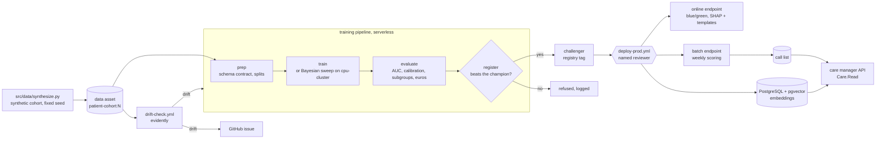
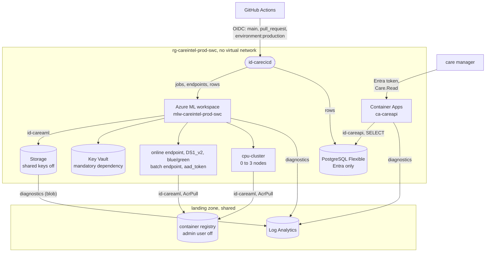

# Architecture

## Lifecycle

A model reaches care managers only through the gate and an approval. Drift starts the pipeline but
never passes the gate on its own (ADR-007), and the gate never promotes (ADR-003, ADR-004).

| Stage | Workflow | Trigger | Ends at |
|---|---|---|---|
| dev | `train-dev.yml` | pull request | a comment with the run, the metrics and the gate's decision |
| staging | `train-staging.yml` | merge to `main` | a challenger or a refusal, with the comparison on the run |
| production | `deploy-prod.yml` | dispatch, approved by a named reviewer | 10 % then 100 % of traffic, champion tag, batch and embeddings refreshed |
| operations | `batch-weekly.yml` | Mondays 06:00 UTC | this week's call list in PostgreSQL |
| monitoring | `drift-check.yml` | Mondays 05:00 UTC | an issue and a retraining run, or nothing |
| quality | `ci.yml` | pull request | lint, types, tests, budget, component schemas, Bicep, gitleaks |

## Network and identity

There is no private network, by the landing zone's decision; every arrow is an Entra-authenticated
call with the narrowest role (`docs/security.md`, ADR-014). Alerts go to the landing zone's action
group: a failed run in the workspace, and server errors from the API. Drift raises a GitHub issue,
because it is computed in a workflow (ADR-007).
