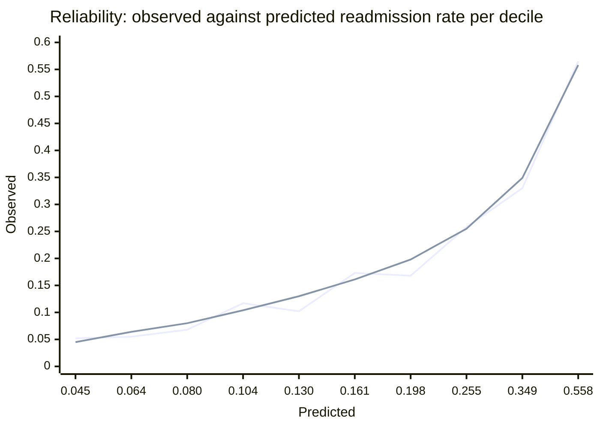

# Evaluation

> Every number below comes from a synthetic cohort (ADR-008). It describes this generator and the
> models trained on it, not any real population.

**Model:** `readmission-risk` v1, the champion · **Data:** `patient-cohort:1` · **Split:** the test
split written by `prep` with seed 7, 6,000 patients, 1,133 of them readmitted · **Artefact:**
[`evaluation-v1.json`](evaluation-v1.json), the report `evaluate` wrote in run
`sweet_whistle_z17tfhcdr9`, which retrained the champion's exact configuration on the same data
asset and seed, reproduced its metrics to the last digit and was refused by the gate as a tie.

## Headline

| Metric | Value | Question it answers |
|---|---|---|
| **Cost avoided per thousand contacts** | **875,000 €** | what the ranking is worth under the programme's capacity |
| Precision among the 120 contacted, top 2 % | 0.758 | how many of the patients called would have been readmitted |
| AUC | 0.756 | whether readmitted patients rank above the others |
| Average precision | 0.459 | how concentrated readmissions are at the top of the list |
| Brier score | 0.129 | whether the probabilities are honest |
| Expected calibration error, ten equal-count bins | 0.014 | the same, bin by bin |

The euro figure rests on modelling assumptions stated with it every time: 35 € per contact, 4,800 €
per readmission, and an intervention that prevents 25 % of the readmissions it reaches. With 120
contacts in the split, one readmitted patient found or missed moves it by 10,000 €.

## Calibration

The expected value of a contact is computed from the probability, so the probability has to be
honest. Predicted against observed readmission rate per decile of score:

| Decile | Predicted | Observed |
|---|---|---|
| 1 | 0.045 | 0.052 |
| 2 | 0.064 | 0.055 |
| 3 | 0.080 | 0.068 |
| 4 | 0.104 | 0.117 |
| 5 | 0.130 | 0.102 |
| 6 | 0.161 | 0.173 |
| 7 | 0.198 | 0.168 |
| 8 | 0.255 | 0.258 |
| 9 | 0.349 | 0.330 |
| 10 | 0.558 | 0.565 |

The second line is the diagonal. The largest gap is three points, in the fifth and seventh deciles.

## Operating point

| Policy | Contacts | Precision | Cost avoided per thousand |
|---|---|---|---|
| Capacity, top 2 % | 120 | 0.758 | 875,000 € |
| F1-optimal threshold | 1,863 | 0.382 | 423,000 € |
| Break-even probability | 6,000 | 0.189 | 192,000 € |

Experiment 002 and ADR-005 argue the choice; `evaluate` logs all three on every run.

## Subgroups

The audit looks at the contacted set: who is called, and who among the readmitted is reached.
Ratios are lowest over highest group value, so 1.0 is parity.

| Attribute | Group | Patients | Readmission | AUC | Selection | Recall | Precision |
|---|---|---|---|---|---|---|---|
| Sex | female | 3,106 | 0.192 | 0.759 | 0.020 | 0.086 | 0.836 |
| | male | 2,894 | 0.186 | 0.753 | 0.020 | 0.074 | 0.678 |
| Language barrier | no | 5,534 | 0.187 | 0.758 | 0.020 | 0.080 | 0.755 |
| | yes | 466 | 0.210 | 0.736 | 0.021 | 0.082 | 0.800 |
| Age band | under 65 | 2,256 | 0.122 | 0.698 | 0.001 | 0.004 | 0.500 |
| | 65 to 74 | 2,170 | 0.158 | 0.729 | 0.008 | 0.041 | 0.778 |
| | 75 and over | 1,574 | 0.327 | 0.737 | 0.064 | 0.148 | 0.760 |
| Deprivation | low | 1,679 | 0.167 | 0.738 | 0.015 | 0.075 | 0.808 |
| | medium | 3,079 | 0.185 | 0.760 | 0.018 | 0.068 | 0.709 |
| | high | 1,242 | 0.226 | 0.763 | 0.031 | 0.110 | 0.795 |
| Insurance | public | 3,560 | 0.189 | 0.764 | 0.021 | 0.086 | 0.763 |
| | private | 1,848 | 0.192 | 0.753 | 0.020 | 0.082 | 0.784 |
| | none | 592 | 0.179 | 0.721 | 0.012 | 0.038 | 0.571 |

| Attribute | Selection parity | Recall parity | Precision parity |
|---|---|---|---|
| Sex | 0.96 | 0.87 | 0.81 |
| Language barrier | 0.93 | 0.98 | 0.94 |
| Age band | **0.01** | **0.03** | 0.64 |
| Deprivation | 0.49 | 0.62 | 0.88 |
| Insurance | 0.55 | **0.44** | 0.73 |

The age gap follows a real difference in risk in the generator; the insurance gap is a small-group
effect, since insurance has no causal role in the generator. Experiment 003 measures what closing
each one costs.

## Other models

Experiment 001 compares the logistic regression, which ties the boosted model on this cohort.
The Bayesian sweep run `good_receipt_0y04c32yb9`, twelve trials on `cpu-cluster` on 2026-10-21,
found a configuration that avoids 905,000 € per thousand contacts on the same test split, with
precision 0.783, AUC 0.755 and calibration error 0.011; the gate registered it as challenger v3.
Three more readmitted patients found among 120 contacts is close to the noise of the split, and
promoting it is the reviewer's decision in `deploy-prod.yml`. `train-staging.yml` publishes every
sweep's best trial against the champion the same way.
